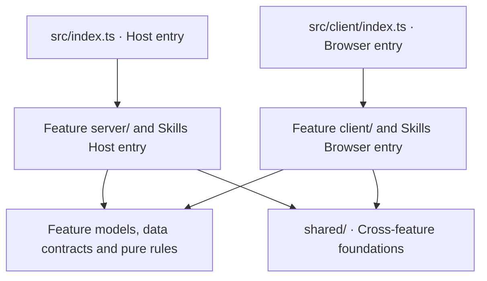

# dsh-custom-center

[中文](README.zh.md)

A standalone **DSH Web GUI plugin** that adds three dedicated pages to the
Settings sidebar: **Appearance**, **Context & Compaction** and **Skills**.
Appearance reskins the DeepSeek Harness UI with a custom image/video wallpaper
whose palette is sampled from the picture; Context & Compaction sets the model
context window and the automatic compaction policy; Skills manages DSH's own
skills and shows other agents' skills so you can sync them into DSH (derived
from [dsh-skills-manager](https://github.com/MichengAI/dsh-skills-manager)).

Unlike a General-settings row, the plugin registers its own first-level
`settings.section` entries, so they appear as separate pages in the settings
navigation (alongside General, Models, Plugins, ...).

## Features

- **Wallpaper library** — click the picture to open a library with an Images
  tab and a Videos tab. **Upload** (the dashed tile at the start of the grid) copies files into `<DSH home>/background/`
  (default `~/.dsh/background/`), sorted into `images/` and `videos/`; click a
  thumbnail to use it. Images up to 50 MB, videos up to 512 MB; the file
  content must match its extension.
- **Custom image wallpaper** — any PNG / JPG / WebP; the palette (surface,
  accent, interaction highlights) is derived from the image's dominant colours.
- **Video wallpaper** — MP4 / WebM looped as a live background; the first frame
  drives the palette.
- **Left and right veil sliders** — tune the wallpaper veil of the sidebar and of the main area separately, or tick the sync checkbox (next to the body enhancement one) to move both together. Hints show on hover.
- **Input opacity slider** — tune the composer/input well independently.
- **Emphasize body text** — an optional frosted scrim under assistant prose.
- **Preview and save** — edits (wallpaper, sliders, body-text toggle) only change
  a draft. **Preview** enters a preview mode where the draft is shown on the live UI and
  every further change takes effect immediately, without being stored. **Save**
  persists it, **Exit preview** returns to the saved look, **Discard** also drops
  the draft.
- **Restore default** — a button at the bottom of the page that clears the
  wallpaper, palette and every stored setting.
- **Context and compaction page** — a settings page next to Appearance. It reads
  the current default model's maximum context and output reserve and lets you
  tune each agent preset's automatic compaction: threshold ratio, headroom,
  retention mode (window fraction or fixed tokens) and the auto switch. Saving
  goes through `configEditor` into the active profile's `cordis.patch.yml` and
  is hot-applied by the Loader; the preview uses the same threshold formula as
  DSH. A scope dropdown picks which models the window is written to: one
  model, every model of a provider, or all editable models at once. The host
  enumerates them through `llm.listProviders` / `llm.listModels`; the browser
  never sends a list of ids. **Restore recommended** fills in 272k maximum context, a 32768 output
  reserve, a 0.8 threshold ratio and 16384 headroom (not yet saved).
- **Skills page** — derived from dsh-skills-manager 1.2.11, with one core
  change: other agents' skill folders (Codex, Claude Code, Copilot and the
  rest) are **view-and-sync only**. DSH no longer loads them directly.
  - The **Other agents** tab lists them read-only with a sync status: not
    synced, synced, source updated, or a same-name skill already in DSH.
  - **Sync to DSH** copies a skill (one, or all of a source) into
    `~/.dsh/skills`; on the project view it copies into that project's
    `.dsh/skills`. It is a one-time copy, never a link, and source files are
    never modified. Later edits to the source only flip the status to
    "source updated"; sync again by hand. A same-name skill in DSH is skipped
    unless you tick overwrite, and the old version goes to trash first.
  - Only skills in DSH's own folders are loaded by DSH, and only those have
    enable/disable switches (a local policy that never edits skill files).
  - Everything else is unchanged: create skills, import ZIP / folder /
    `SKILL.md`, trash, categories, an optional sidebar entry, and the
    `create_skill` tool (asks before running). The original plugin's
    Discover tab (GitHub repositories, ClawHub, skills.sh), self-update check
    and GitHub link buttons were left out. Turn the page off with the `skills` switch in the
    plugin settings.

The palette engine keeps WCAG contrast against the skin's own surface by
construction (contrast-checked text, accent and focus colours).

Legibility over a photo is checked rather than assumed:

- The composer caret, slash-command chip, send button and hover rows use a
  contrast-checked version of the wallpaper accent, so a pale or grey accent
  no longer disappears into the input well.
- Solid accent fills (the selected settings row, primary buttons, switches)
  take a readable label colour, and fall back to a tinted wash when the accent
  cannot carry body text. An accent that is nearly the same as the panel is
  lifted just enough to be seen.
- The wallpaper's lightness profile is stored with the skin. When the host is
  in light appearance and the wallpaper is mostly too dark for dark text even
  under the veil, the palette switches to the dark one (light text, dark input
  well) and sets the host's dark attribute so its own dark styles apply. Other
  wallpapers keep the host appearance, and a dark host is never switched to
  light. Wallpapers saved earlier recover the profile automatically.

## How it mounts

| Part | State |
| --- | --- |
| Bundle manifest | `dsh.bundle.patch` points at `cordis.patch.yml` |
| Loader row | `ui-custom-center` -> package `dsh-custom-center` |
| Host half | `src/index.ts`: `Config.enabled` / `Config.skills` settings page plus the wallpaper library routes (`src/appearance/server/library.ts`), the context/compaction routes (`src/tuning/server/routes.ts`) and the skills child plugin (`src/skills/index.ts`, injects `skills`, `tools`, `sessions`) |
| Browser half | `src/client/index.ts`: registers the Appearance and Context & Compaction `settings.section` pages and mounts the Skills page as a child plugin (`src/skills/client.ts`, injects `locale`) |
| Feature logic | `src/appearance/` (colour, palette, sampling, media rules), `src/tuning/` (model window and compaction), and existing tests |
| Shared boundary | `src/shared/`: plugin config, cross-feature page/control styles, browser/host adapters, request marker and loopback check |
| Build | `tsc` declarations + `tsdown` host/client bundles |

The browser half registers into the `settings.section` slot (full settings
pages, each with its own nav entry), not `settings.general.item`. The skills
module mounts as a separate Cordis child plugin on both halves: if the host
lacks a service it needs, only the Skills page is missing.

## Code structure

Source is organized by feature: appearance (`appearance`), context and compaction
(`tuning`), and skills (`skills`). Each feature separates browser UI and interaction
(`client/`), host services and side effects (`server/`), and data contracts and pure
rules that do not depend on either environment. Cross-feature foundations live in
`shared/`. The package entries, `src/index.ts` and `src/client/index.ts`, only assemble
these modules; Skills retains its own child-plugin entries.

The tree shows the main files. See [Architecture](docs/architecture.md) for the
complete file-by-file reference.

```text
dsh-custom-center/
  src/
    index.ts                  # Host assembly: routes + Skills child plugin
    client/
      index.ts                # Browser assembly: pages + lifecycle
      settings-nav.ts         # settings navigation markers
      styles.ts               # stylesheet assembly and injection
    appearance/
      client/
        AppearancePage.tsx    # appearance UI
        LibraryPicker.tsx     # wallpaper library UI
        controller.ts         # saved/draft/live state and preview lifecycle
        model.ts              # appearance configuration and defaults
        storage.ts            # localStorage / IndexedDB persistence
        host-appearance.ts    # host DOM, tokens, wallpaper and URL resources
        wallpaper.ts          # image/video decoding and sampling
        library.ts            # wallpaper library HTTP client
        styles.ts             # appearance and host wallpaper styles
      server/library.ts       # wallpaper list/upload/file routes
      color.ts                # colour and contrast maths
      skins.ts                # seeds -> token map
      sample.ts               # pure pixel sampling
      tone.ts                 # lightness profile and appearance rules
      media.ts                # media, names and Range rules
    tuning/
      contracts.ts            # cross-end request/snapshot types
      rules.ts                # validation, defaults and budget formula
      config-mapping.ts       # pure profile configuration transforms
      targets.ts              # model scope and target selection
      client/
        TuningPanel.tsx       # page and panel assembly (includes TuningPage)
        useTuningForm.ts      # state, loading, derived values and saving
        ModelWindowPanel.tsx  # model-window render function
        CompactionPanel.tsx   # compaction render function
        fields.tsx            # tuning fields
        Select.tsx            # tuning dropdown
        api-client.ts         # tuning HTTP client
        styles.ts             # tuning styles
      server/
        routes.ts             # HTTP protocol and guards
        host-env.ts           # tuning host interfaces
        model-access.ts       # host model enumeration and lookup
        snapshot.ts           # read-side composition
        save.ts               # ordered configuration writes
    skills/
      index.ts                # Host child-plugin assembly
      client.ts               # Browser child-plugin assembly
      model.ts                # domain types
      contracts.ts            # cross-end data/API contracts
      browser-host.ts         # browser host adapter types
      host-types.ts           # Skills host adapter types
      server/
        router.ts             # HTTP dispatch, queueing and responses
        http-policy.ts        # origin checks, request marker and body limits
        request-scope.ts      # request/session project and target scope
        commands.ts           # shared HTTP/tool queue and orchestration
        queries.ts            # page and workspace snapshot composition
        provider.ts           # loadable skill selection and read revalidation
        create-skill-tool.ts  # create_skill tool registration
        host-integration.ts   # host notifications, workspaces and adapters
        skill-*.ts            # scan, document, create, import and sync
        upload-import.ts      # file/directory/ZIP upload import
        file-operations.ts    # file-tree checks and copying
        policy-store.ts       # policy state persistence
        policy.ts             # skill/source enablement policies
        categories.ts         # categories, assignment and ordering
        trash.ts              # trash, restore and permanent deletion
      client/
        manager-page.tsx      # page and session composition
        useSkillCatalog.ts    # skill snapshots and refresh lifecycle
        useWorkspaceCatalog.ts # workspace lists, details and cache
        useSkillCommands.ts   # shared busy/inflight and request execution
        useSkillFilters.ts    # derived filters, lists and counts
        useSkillCreate.ts     # creation workflow
        useSkillImport.ts     # import workflow
        useSkillDetail.ts     # detail loading, copying and feedback
        useSkillSync.ts       # sync workflow
        useSkillCategories.ts # category workflows and batch operations
        *-dialog.tsx          # create, import, detail and sync dialogs
        *-dialogs.tsx         # category and deletion confirmation dialogs
        source-tree.tsx       # source and category tree
        skill-rows.tsx        # skill rows and drag/drop events
        scope-panels.tsx      # user, project and trash panels
        api-client.ts         # ordinary/session HTTP client
        selectors.ts          # pure filtering and statistics
        uploads.ts            # upload checks and request encoding
        messages.ts           # translation and result message composition
        locales/              # Chinese and English dictionaries
        styles.ts             # Skills styles
    shared/
      config.ts               # plugin configuration and defaults
      browser-env.ts          # browser host interfaces and slot types
      host-env.ts             # cross-feature Host interfaces
      request.ts              # shared appearance/tuning request conventions
      styles.ts               # cross-feature page and control styles
  tests/                      # feature, contract, lifecycle and architecture tests
  docs/architecture.md        # current per-file responsibilities and boundaries
```

### Responsibilities and call paths

| Module | Responsibility and main call path |
| --- | --- |
| Entries and lifecycle | The Host entry mounts routes and child plugins. The Browser entry registers pages, creates the appearance controller, injects styles and disposes subscriptions. Business logic stays within each feature. |
| Appearance state | `AppearancePage.tsx` forwards user events to `controller.ts`, which owns saved/draft/live state, preview, save, discard and reset. `storage.ts` owns persistence; `host-appearance.ts` owns DOM, tokens, wallpaper elements and URL resources; `wallpaper.ts` owns decoding and sampling. |
| Appearance rules and library | `color.ts`, `skins.ts`, `sample.ts`, `tone.ts` and `media.ts` provide pure calculations and media rules. `LibraryPicker.tsx` calls `server/library.ts` through `client/library.ts`; wallpaper file access stays on the host. |
| Tuning | `TuningPanel.tsx` composes the page regions. `useTuningForm.ts` owns the form and calls `server/routes.ts` through `api-client.ts`. Reads go to `snapshot.ts`, writes to `save.ts`, and host model access to `model-access.ts`. Validation and budget formulas live in `rules.ts`; configuration transforms live in `config-mapping.ts`. Both region files export ordinary render functions. |
| Skills browser | `manager-page.tsx` composes focused hooks for catalogs, request exclusion, filters, creation, import, details, sync and categories. Dialog files own presentation, `api-client.ts` owns HTTP handling, and `selectors.ts` owns pure list derivation. |
| Skills host | `router.ts` handles the protocol, `request-scope.ts` resolves scope, `commands.ts` orchestrates operations, and file modules perform filesystem changes. HTTP and the `create_skill` tool share one commands instance and queue. `queries.ts` composes page data; `provider.ts` handles DSH skill loading. |
| Styles | Each feature owns its `client/styles.ts`; `shared/styles.ts` owns cross-feature foundations. `src/client/styles.ts` combines them in the established cascade order and injects them idempotently. |

Appearance subscriptions, timers, asynchronous restoration and URL cleanup belong
to the controller and host adapter. The Skills shell owns scope, saved filters and
expansion state; the view remounted by session key owns requests, forms and dialogs.
Ordinary operations, opening folders and category batches share request exclusion
state, preserving the existing refresh and unlock order.

### Dependency rules



- Appearance, tuning and skills do not import each other. Move foundations into `shared/` only when they are actually reused across features.
- `shared/` does not depend on features or entries, and feature implementations do not import entries at runtime. Keep the runtime dependency graph acyclic.
- Browser runtime dependencies must not reach `server/`, Node built-ins or Host adapters. Share only data contracts, pure rules and pure types across environments; send HTTP requests through the respective client wrappers.
- SDK types come from official `@deepseek-ai/*` npm packages. Describe unpublished host capabilities with narrow local interfaces rather than references to a DSH source checkout.
- Pages own presentation and event wiring; hooks/controllers own state and workflows; pure rules own calculations; host adapters and storage own side effects. Place new code by responsibility without merging all workflows into one page or manager.

### Where to make changes

Paths below are relative to `src/`.

| Change | Start here |
| --- | --- |
| Settings registration, enablement and disposal | `index.ts`, `client/index.ts`, `shared/config.ts` |
| Appearance preview, save and restoration | `appearance/client/controller.ts`, `storage.ts`, `host-appearance.ts` |
| Wallpaper colour, lightness and media rules | `appearance/color.ts`, `skins.ts`, `sample.ts`, `tone.ts`, `media.ts` |
| Tuning validation, recommendations and budget formulas | `tuning/rules.ts`, `contracts.ts`, and `tuning/client/fields.tsx` |
| Tuning model queries and configuration writes | `tuning/server/model-access.ts`, `snapshot.ts`, `save.ts`, and `tuning/config-mapping.ts` |
| Skill creation, import, detail or sync interactions | The corresponding `useSkill*.ts` and dialog files in `skills/client/` |
| Skill HTTP/tool operations | `skills/contracts.ts`, `skills/server/router.ts`, `commands.ts` and the relevant capability module; the tool entry is `create-skill-tool.ts` |
| Skill enablement, categories or trash | `skills/server/policy.ts`, `categories.ts`, `trash.ts` |
| Copy and styles | `skills/client/messages.ts`, `locales/`; each feature's `client/styles.ts` and `shared/styles.ts` |

### Tests and architecture constraints

| Coverage | Tests in `tests/` |
| --- | --- |
| Dependency direction, browser boundaries, cycles and the 800-line source-file limit | `architecture.spec.ts` |
| Appearance controller, colour, sampling and media rules | `appearance-controller.spec.ts`, `color.spec.ts`, `skins.spec.ts`, `sample.spec.ts`, `media.spec.ts` |
| Configuration and wallpaper library routes | `config.spec.ts`, `library.spec.ts` |
| Tuning rules and host read/write contracts | `tuning.spec.ts`, `host-tuning.spec.ts` |
| Skills browser data and session lifecycle | `skills-client-data.spec.ts`, `skills-client-lifecycle.spec.ts` |
| Skills files, routes, policy state and sync | `skills-files.spec.ts`, `skills-routes.spec.ts`, `skills-state.spec.ts`, `skills-sync.spec.ts` |

Type-check and test commands are listed under Commands below. These checks do not
replace visual, interaction and lifecycle checks in a running host.
See [Validation](docs/responsibility-refactoring-validation.md) for refactoring
evidence and verification limits.

## Install for development

Requirements: Node.js 22+, pnpm, and a DSH host whose version satisfies
`>= 0.2.1-rc.2`.

```sh
cd /Users/mac/Documents/code/dsh/dsh-custom-center
pnpm install
pnpm build
dsh plugin --profile web add link:$(pwd)
# refresh the DSH Web GUI afterwards
```

After the refresh, open Settings — **Appearance**, **Context & Compaction** and
**Skills** entries appear in the sidebar. In Appearance, choose an image/video wallpaper,
press Preview to try it (changes apply live), then Save to keep it; Restore
default clears everything. In Context & Compaction, adjust the model window and
compaction values, then press Save. In Skills, open **Other agents** to
review another agent's skills and sync the ones you want into DSH.

Remove it again:

```sh
dsh plugin --profile web remove dsh-custom-center
```

## Commands

```sh
pnpm typecheck   # tsc -p tsconfig.json --noEmit
pnpm test        # vitest run
pnpm build       # declarations + lib/index.js + lib/client.js
pnpm watch       # rebuild bundles while developing
```

## What the build emits

- `lib/index.js` — host half, ESM, Node platform; Cordis and Schemastery stay
  external because the host provides them.
- `lib/client.js` — browser half wrapped as:

  ```js
  window.__ModuleLoader__.load({ id: 'dsh-custom-center', factory: (require) => { ... } })
  ```

  The shell module table (`react`, `react/jsx-runtime`, ...) is external;
  everything else is inlined.
- `lib/types/**` — declaration files referenced by the package `exports`.

## Notes

- No DSH source patch. Uninstalling restores the native appearance; files in
  the library folder are yours and are never deleted by the plugin.
- Wallpapers never leave the machine. The chosen image persists in
  localStorage and the chosen video in IndexedDB; the library folder keeps the
  originals.
- The library routes (`/custom-center/list`, `/upload`, `/file`) accept only
  loopback sockets, go through the Connection Host/Origin fence and browser
  authentication, and `list` / `upload` also need a same-origin marker header.
  The browser never sends a path: files are addressed by `images/<name>` or
  `videos/<name>` and resolved against the server-owned folder; symlinks and
  hidden files are refused.
- The tuning routes (`GET` / `POST /custom-center/tuning`) accept only loopback
  sockets, the Connection fence and the same-origin marker header. They take
  model-window and compaction numbers, never a file path; writes go through
  `configEditor` into the active profile patch, are validated by the owning
  plugin, and reconcile through the Loader.
- The maximum context is the capacity declared by the model route, not a hard
  truncation of one conversation. The trigger threshold is
  `min(window × threshold ratio, window − output reserve − headroom)`, matching
  `compaction-basic`. Compaction is per agent preset, so edits apply to Agents
  created after the change.
- The skin is an orthogonal overlay on the host appearance. It never calls
  `theme.setTheme` (ui-theme owns light/dark); it re-applies its tokens after
  every `theme/change`.
- The installed SDK does not publish the renderer `SlotRegistry` or theme
  service types, so `src/shared/browser-env.ts` declares narrow structural faces
  and augments `SlotMap` with `settings.section`. Replace these with real
  imports if the public SDK widens.
- The skills routes (`/api/dsh-custom-center/skills/*`) keep the original
  checks: only loopback or DSH-trusted Hosts, no cross-site requests; writes
  also need the `x-dsh-custom-center-skills` marker header and JSON. Skill
  state lives in `$DSH_HOME/skills-manager/`, shared with the original plugin,
  so moving over from dsh-skills-manager keeps toggles and categories.
- Skills you have not synced are invisible to DSH. After upgrading from
  dsh-skills-manager, anything that only lived in another agent's folder must
  be synced once to keep working. Sync records are kept in
  `$DSH_HOME/skills-manager/sync-records.json`.
- Do not enable the Skills page alongside `@michengai/dsh-skills-manager`: both
  would register a skill provider and a `create_skill` tool. If you keep the
  original plugin, set this plugin's `skills` switch off.
- License: [MIT](LICENSE). `src/skills/` is ported from dsh-skills-manager under
  [Apache-2.0](LICENSE-skills-manager).
