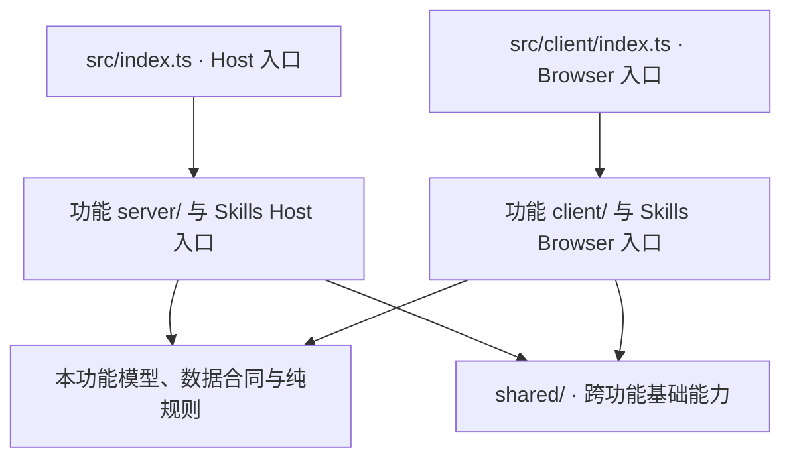

# dsh-custom-center

[English](README.md)

一个独立的 **DSH Web GUI 插件**，在设置侧边栏里新增三个独立页面：「外观」、
「上下文与压缩」和「技能」。「外观」用自定义图片 / 视频壁纸给 DeepSeek Harness
界面换肤，配色自动跟随画面主色调；「上下文与压缩」设置模型上下文窗口与自动压缩
阈值；「技能」管理 DSH 自己的技能，并展示其他 Agent 的技能供你同步到 DSH（改自
[dsh-skills-manager](https://github.com/MichengAI/dsh-skills-manager)）。

与「通用设置」里插入一行不同，本插件注册自己的一级 `settings.section` 条目，
因此它们作为独立页面出现在设置导航中（和通用、模型、插件等并列）。

## 功能

- **壁纸库** — 点击图片打开壁纸库，分「图片」和「视频」两个标签。点网格里第一格的「上传」会把
  文件复制到 `<DSH home>/background/`（默认 `~/.dsh/background/`），自动归入
  `images/` 和 `videos/`；点缩略图即可使用。图片最大 50 MB，视频最大 512 MB，
  文件内容必须与扩展名一致。
- **自定义图片壁纸** — 任意 PNG / JPG / WebP，整套配色（背景、强调色、
  交互高亮）自动取自图片主色调。
- **视频动态壁纸** — MP4 / WebM 循环播放当背景，首帧取色生成配色。
- **左右两侧遮罩滑块** — 侧边栏和主区域的遮罩可分别调节，也可以勾选「左右同步」（与「正文加强」同一行）让两侧一起变化，说明在鼠标悬停时显示。
- **输入框不透明度滑块** — 独立调节输入框背景。
- **正文加强开关** — 给助手正文加一层轻磨砂底。
- **预览与保存** — 改动（壁纸、滑块、正文加强）只会修改草稿。点「预览」进入预览模式，草稿显示在当前
  界面，之后的所有更改立即生效但不保存；点「保存」才会持久化，点「退出预览」
  回到已保存的样子，点「撤销更改」同时丢弃草稿。
- **恢复默认** — 页面底部的按钮，清除壁纸、配色和所有已保存的设置。
- **上下文与压缩页面** — 与「外观」并列的设置页。读取当前默认模型的最大上下文与输出预留，并可为每个 agent preset 调整自动压缩阈值、压缩余量、近期保留方式（窗口比例或固定 tokens）与自动压缩开关。保存会通过 `configEditor` 写入当前 profile 的 `cordis.patch.yml` 并由 Loader 热应用；页面用与 DSH 相同的公式预览触发阈值与逐字保留预算。「应用范围」下拉框可选择单个模型、某个 provider 的全部模型，或一次应用到全部可编辑模型；模型列表由宿主通过 `llm.listProviders` / `llm.listModels` 枚举，浏览器不会提交模型 id 列表。「恢复推荐值」会填入最大上下文 272k、输出预留 32768、压缩阈值 0.8、压缩余量 16384（仍需保存）。
- **技能页面** — 改自 dsh-skills-manager 1.2.11，核心行为有一处改动：其他 Agent 的技能目录（Codex、Claude Code、Copilot 等）只做**查看与同步**，DSH 不再直接加载。
  - 「其他 Agent」页签只读列出这些技能，并标出同步状态：未同步、已同步、源已更新、DSH 已有同名。
  - 「同步到 DSH」把技能（单个或某来源全部）复制到 `~/.dsh/skills`；在项目视图下复制到该项目的 `.dsh/skills`。这是一次性复制，不是链接，也不会修改来源文件。之后来源再变化，只会把状态标成「源已更新」，需要时手动再同步。DSH 里已有同名技能时默认跳过，勾选覆盖后才会替换，旧版本先进回收站。
  - 只有位于 DSH 自己目录里的技能才会被 DSH 加载，也只有它们有启停开关（本地策略，不改技能文件）。
  - 其余功能不变：创建技能，导入 ZIP / 文件夹 / `SKILL.md`，回收站，分类，可选的侧边栏入口，以及 `create_skill` 工具（执行前需确认）。原插件的「发现技能」页（GitHub 仓库、ClawHub、skills.sh）、自更新检查与 GitHub 链接按钮未保留。可在插件设置里用 `skills` 开关关闭此页面。

配色引擎在构造上保证对皮肤自身表面的 WCAG 对比度（文字、强调色、焦点色均经
对比度校正）。

壁纸之上的可读性是计算出来的，而不是假定的：

- 输入框光标、斜杠命令 chip、发送按钮和悬停行使用经过对比度校正的壁纸强调色，
  浅色或灰色强调色不会再融进输入框。
- 实心强调色底（设置页选中行、主按钮、开关）会取可读的文字色；强调色无法承载
  正文时退回淡色底。与面板几乎同色的强调色会被适度提亮到可见。
- 皮肤会保存壁纸的明暗分布。当宿主为浅色外观、而壁纸大部分区域即使加了遮罩也
  不适合深色文字时，配色切换为深色（浅色文字、深色输入框），并设置宿主的深色
  属性，让宿主自身的深色样式一并生效。其他壁纸保持宿主外观，深色宿主不会被切成
  浅色。更早保存的壁纸会自动补算该分布。

## 挂载方式

| 部分 | 状态 |
| --- | --- |
| Bundle 清单 | `dsh.bundle.patch` 指向 `cordis.patch.yml` |
| Loader 行 | `ui-custom-center` -> 包名 `dsh-custom-center` |
| Host 半区 | `src/index.ts`：`Config.enabled` / `Config.skills` 设置页 + 壁纸库路由（`src/appearance/server/library.ts`）+ 上下文/压缩路由（`src/tuning/server/routes.ts`）+ 技能子插件（`src/skills/index.ts`，注入 `skills`、`tools`、`sessions`） |
| 浏览器半区 | `src/client/index.ts`：注册「外观」「上下文与压缩」两个 `settings.section` 页面，并以子插件挂载「技能」页（`src/skills/client.ts`，注入 `locale`） |
| 功能逻辑 | `src/appearance/`（配色、皮肤、取色、媒体规则）、`src/tuning/`（模型窗口与压缩）及既有测试 |
| 共享边界 | `src/shared/`：插件配置、跨功能页面/控件样式、浏览器/宿主适配、请求标记与回环判断 |
| 构建 | `tsc` 声明 + `tsdown` host/client 产物 |

浏览器半区注册到 `settings.section` 插槽（带独立导航条目的完整设置页），
而不是 `settings.general.item`。技能模块在两端都作为独立的 Cordis 子插件挂载：
宿主缺少它依赖的服务时只有「技能」页不出现，其余页面不受影响。

## 代码结构

源码按外观（`appearance`）、调优（`tuning`）、技能（`skills`）三个功能组织。
每个功能内部再区分浏览器界面与交互（`client/`）、宿主服务与副作用（`server/`），
以及不依赖运行环境的数据合同和纯规则。跨功能基础能力放在 `shared/`。
`src/index.ts` 和 `src/client/index.ts` 是包的两个入口，只负责装配；Skills 保留独立子插件入口。

以下列出主要文件；完整逐文件说明见[当前架构](docs/architecture.md)。

```text
dsh-custom-center/
  src/
    index.ts                  # Host 装配：路由与 Skills 子插件
    client/
      index.ts                # Browser 装配：页面与生命周期
      settings-nav.ts         # 设置导航标记
      styles.ts               # 样式拼接与注入
    appearance/
      client/
        AppearancePage.tsx    # 外观界面
        LibraryPicker.tsx     # 壁纸库界面
        controller.ts         # saved/draft/live 与预览生命周期
        model.ts              # 外观配置与默认参数
        storage.ts            # localStorage / IndexedDB 持久化
        host-appearance.ts    # 宿主 DOM、token、壁纸和 URL 资源
        wallpaper.ts          # 图片/视频解码与采样
        library.ts            # 壁纸库 HTTP 客户端
        styles.ts             # 外观与宿主壁纸样式
      server/library.ts       # 壁纸 list/upload/file 路由
      color.ts                # 配色与对比度数学
      skins.ts                # 种子色 -> token 映射
      sample.ts               # 像素纯采样
      tone.ts                 # 明暗分布与外观规则
      media.ts                # 媒体、命名与 Range 规则
    tuning/
      contracts.ts            # 跨端请求/快照类型
      rules.ts                # 校验、默认值与预算公式
      config-mapping.ts       # profile 配置的纯变换
      targets.ts              # 模型作用域与目标选择
      client/
        TuningPanel.tsx       # 页面与区域装配（内含 TuningPage）
        useTuningForm.ts      # 状态、加载、派生值与保存
        ModelWindowPanel.tsx  # 模型窗口区域渲染函数
        CompactionPanel.tsx   # 压缩区域渲染函数
        fields.tsx            # 调优字段
        Select.tsx            # 调优下拉框
        api-client.ts         # 调优 HTTP 客户端
        styles.ts             # 调优样式
      server/
        routes.ts             # HTTP 协议与守卫
        host-env.ts           # 调优宿主接口
        model-access.ts       # 宿主模型枚举与定位
        snapshot.ts           # 查询快照组合
        save.ts               # 顺序执行配置写入
    skills/
      index.ts                # Host 子插件装配
      client.ts               # Browser 子插件装配
      model.ts                # 领域类型
      contracts.ts            # 跨端数据/API 合同
      browser-host.ts         # 浏览器宿主适配类型
      host-types.ts           # Skills 宿主适配类型
      server/
        router.ts             # HTTP 分发、入队与响应
        http-policy.ts        # 来源校验、请求标记与 body 限额
        request-scope.ts      # 请求/session 的项目和目标作用域
        commands.ts           # HTTP/工具共用队列与业务编排
        queries.ts            # 页面与工作区快照组合
        provider.ts           # 可加载技能筛选与读取复验
        create-skill-tool.ts  # create_skill 工具注册
        host-integration.ts   # 宿主通知、工作区与服务适配
        skill-*.ts            # 扫描、文档、创建、导入、同步能力
        upload-import.ts      # 上传文件/目录/ZIP 导入
        file-operations.ts    # 文件树检查与复制
        policy-store.ts       # 策略状态持久化
        policy.ts             # 技能/来源启停策略
        categories.ts         # 分类、分配与顺序
        trash.ts              # 回收、恢复与永久删除
      client/
        manager-page.tsx      # 页面与 session 组合
        useSkillCatalog.ts    # 技能快照与刷新生命周期
        useWorkspaceCatalog.ts # 工作区列表、详情与缓存
        useSkillCommands.ts   # 共用 busy/inflight 与请求执行
        useSkillFilters.ts    # 筛选、列表与计数派生
        useSkillCreate.ts     # 创建流程
        useSkillImport.ts     # 导入流程
        useSkillDetail.ts     # 详情读取、复制与反馈
        useSkillSync.ts       # 同步流程
        useSkillCategories.ts # 分类流程与批量操作
        *-dialog.tsx          # 创建、导入、详情、同步弹窗
        *-dialogs.tsx         # 分类与删除确认弹窗
        source-tree.tsx       # 来源与分类树
        skill-rows.tsx        # 技能行与拖放事件
        scope-panels.tsx      # 用户、项目、回收站面板
        api-client.ts         # 普通/session HTTP 客户端
        selectors.ts          # 纯筛选与统计
        uploads.ts            # 上传检查与请求编码
        messages.ts           # 翻译和结果文案组合
        locales/              # 中文、英文词典
        styles.ts             # 技能样式
    shared/
      config.ts               # 插件配置与默认值
      browser-env.ts          # 浏览器宿主接口与插槽类型
      host-env.ts             # 跨功能 Host 接口
      request.ts              # 外观/调优共用请求约定
      styles.ts               # 跨功能页面与控件基础样式
  tests/                      # 功能、合同、生命周期与架构测试
  docs/architecture.md        # 当前逐文件职责与依赖边界
```

### 模块职责与调用关系

| 模块 | 职责边界与主要调用关系 |
| --- | --- |
| 入口与生命周期 | Host 入口挂载路由和子插件；Browser 入口注册页面、创建外观控制器、注入样式并清理订阅。具体业务留在功能内部。 |
| 外观状态 | `AppearancePage.tsx` 将用户事件交给 `controller.ts`；controller 管理 saved/draft/live、预览、保存、撤销和重置。`storage.ts` 负责持久化，`host-appearance.ts` 负责 DOM、token、壁纸元素与 URL 资源，`wallpaper.ts` 负责解码和采样。 |
| 外观规则与壁纸库 | `color.ts`、`skins.ts`、`sample.ts`、`tone.ts`、`media.ts` 提供纯计算与媒体规则。`LibraryPicker.tsx` 经 `client/library.ts` 调用 `server/library.ts`，由宿主处理壁纸文件读写。 |
| 调优 | `TuningPanel.tsx` 组合页面区域，`useTuningForm.ts` 管理表单并通过 `api-client.ts` 请求 `server/routes.ts`。查询交给 `snapshot.ts`，写入交给 `save.ts`，宿主模型访问集中在 `model-access.ts`。校验与预算公式放在 `rules.ts`，配置结构变换放在 `config-mapping.ts`。两个区域文件导出普通渲染函数。 |
| 技能浏览器 | `manager-page.tsx` 组合各职责 hook；目录、请求互斥、筛选、创建、导入、详情、同步和分类各有独立模块。弹窗文件负责展示，HTTP 封装留在 `api-client.ts`，纯列表派生留在 `selectors.ts`。 |
| 技能宿主 | `router.ts` 处理协议，`request-scope.ts` 解析作用域，`commands.ts` 编排具体操作，文件能力模块负责落盘。HTTP 与 `create_skill` 工具共用同一个 commands 实例和队列；页面查询由 `queries.ts` 组合，DSH 技能加载由 `provider.ts` 负责。 |
| 样式 | 各功能的 `client/styles.ts` 拥有本功能样式，`shared/styles.ts` 拥有跨功能基础样式；最终由 `src/client/styles.ts` 按既定级联顺序拼接并幂等注入。 |

外观的订阅、定时器、异步恢复和 URL 释放归控制器与宿主适配层管理。
技能页面的 scope、已保存筛选和展开状态归壳层，按 session key 重挂载的视图持有请求、表单和弹窗状态。
普通操作、打开目录和分类批量操作共用请求互斥状态，保持现有刷新与解锁时序。

### 依赖规则



- 外观、调优、技能之间不互相导入；确有跨功能复用的基础能力才放进 `shared/`。
- `shared/` 不反向依赖功能或入口，功能实现不在运行时导入入口；运行时依赖图保持无环。
- 浏览器运行时依赖不能到达 `server/`、Node 内置模块或 Host 适配。跨端共享限于数据合同、纯规则和纯类型；HTTP 请求通过各自客户端封装。
- SDK 类型来自正式的 `@deepseek-ai/*` npm 包；尚未公开的宿主能力用本地窄接口描述，不引用 DSH 源码目录。
- 页面负责展示和事件连接，hook/controller 负责状态与流程，纯规则负责计算，宿主适配与存储模块负责副作用。新增代码按职责放置，不把所有流程重新聚合进一个页面或 manager。

### 常见修改定位

下表路径均相对 `src/`。

| 修改内容 | 优先定位 |
| --- | --- |
| 设置页注册、启停和卸载清理 | `index.ts`、`client/index.ts`、`shared/config.ts` |
| 外观预览、保存、恢复流程 | `appearance/client/controller.ts`、`storage.ts`、`host-appearance.ts` |
| 壁纸颜色、明暗与媒体规则 | `appearance/color.ts`、`skins.ts`、`sample.ts`、`tone.ts`、`media.ts` |
| 调优字段校验、推荐值、预算公式 | `tuning/rules.ts`、`contracts.ts`，以及 `tuning/client/fields.tsx` |
| 调优模型查询与配置写入 | `tuning/server/model-access.ts`、`snapshot.ts`、`save.ts`，以及 `tuning/config-mapping.ts` |
| 技能创建、导入、详情或同步交互 | `skills/client/` 中对应的 `useSkill*.ts` 与弹窗文件 |
| 技能 HTTP/工具操作 | `skills/contracts.ts`、`skills/server/router.ts`、`commands.ts` 及对应能力文件；工具入口为 `create-skill-tool.ts` |
| 技能启停、分类或回收站 | `skills/server/policy.ts`、`categories.ts`、`trash.ts` |
| 文案与样式 | `skills/client/messages.ts`、`locales/`；各功能 `client/styles.ts` 与 `shared/styles.ts` |

### 测试与架构约束

| 检查范围 | 对应测试（位于 `tests/`） |
| --- | --- |
| 依赖方向、浏览器边界、循环依赖、源码单文件 800 行上限 | `architecture.spec.ts` |
| 外观控制器与配色、采样、媒体规则 | `appearance-controller.spec.ts`、`color.spec.ts`、`skins.spec.ts`、`sample.spec.ts`、`media.spec.ts` |
| 配置与壁纸库路由 | `config.spec.ts`、`library.spec.ts` |
| 调优规则与宿主读写合同 | `tuning.spec.ts`、`host-tuning.spec.ts` |
| 技能浏览器数据与 session 生命周期 | `skills-client-data.spec.ts`、`skills-client-lifecycle.spec.ts` |
| 技能文件、路由、策略状态与同步 | `skills-files.spec.ts`、`skills-routes.spec.ts`、`skills-state.spec.ts`、`skills-sync.spec.ts` |

类型检查与测试命令见下方「常用命令」。这些检查不能替代真实宿主中的视觉、交互和生命周期验收。
重构证据与验证限制见[职责重构验证记录](docs/responsibility-refactoring-validation.md)。

## 开发安装

要求：Node.js 22+、pnpm，以及满足 `>= 0.2.1-rc.2` 的 DSH 宿主。

```sh
cd /Users/mac/Documents/code/dsh/dsh-custom-center
pnpm install
pnpm build
dsh plugin --profile web add link:$(pwd)
# 完成后刷新 DSH Web 界面
```

刷新后打开「设置」，侧边栏会出现「外观」「上下文与压缩」「技能」三个条目。在「外观」里点
「选择图片 / 视频」设置壁纸，先「预览」（预览中所有更改立即生效），满意再「保存」；
「恢复默认」会清除全部设置。在「上下文与压缩」里调整模型窗口与压缩参数后点「保存」。在「技能」页打开「其他 Agent」页签，
可以查看其他 Agent 的技能，并把需要的同步到 DSH。

卸载：

```sh
dsh plugin --profile web remove dsh-custom-center
```

## 常用命令

```sh
pnpm typecheck   # tsc -p tsconfig.json --noEmit
pnpm test        # vitest run
pnpm build       # 声明文件 + lib/index.js + lib/client.js
pnpm watch       # 开发时监听重建
```

## 构建产物

- `lib/index.js` — Host 半区，ESM、Node 平台；Cordis 与 Schemastery 保持
  external，由宿主提供。
- `lib/client.js` — 浏览器半区，包装为：

  ```js
  window.__ModuleLoader__.load({ id: 'dsh-custom-center', factory: (require) => { ... } })
  ```

  壳层模块表（`react`、`react/jsx-runtime` 等）保持 external，其余依赖内联。
- `lib/types/**` — 包 `exports` 引用的声明文件。

## 说明

- 不改 DSH 源码。卸载后恢复原生外观；壁纸库文件夹里的文件属于你，插件不会删除。
- 壁纸只在本机流转：选中的图片存 localStorage，选中的视频存 IndexedDB，原文件
  保存在壁纸库文件夹，不上传任何服务器。
- 壁纸库路由（`/custom-center/list`、`/upload`、`/file`）只接受回环 socket，
  经过 Connection 的 Host/Origin 校验和浏览器鉴权；`list` / `upload` 还要求带
  同源标记头。浏览器从不发送路径：文件用 `images/<名称>` 或 `videos/<名称>`
  标识，由服务端在自有目录内解析；符号链接和隐藏文件一律拒绝。
- 上下文/压缩路由（`GET` / `POST /custom-center/tuning`）同样只接受回环 socket、
  Connection 校验和同源标记头。它只接收模型窗口与压缩数字，不接受文件路径；
  写入通过 `configEditor` 落到当前 profile 的 patch，先由目标插件校验，再由
  Loader 热应用。
- 最大上下文是模型路由声明的容量，不是对单次对话的硬截断；压缩阈值按
  `min(最大上下文 × 压缩阈值, 最大上下文 − 输出预留 − 压缩余量)` 计算，公式与
  `compaction-basic` 一致。压缩设置按 agent preset 生效，修改只影响之后创建的
  Agent。
- 皮肤是叠加在宿主外观之上的正交层：不调用 `theme.setTheme`（浅色/深色由
  ui-theme 管理），并在每次 `theme/change` 后重新写回 token。
- 当前安装的 SDK 未发布 renderer 的 `SlotRegistry` 和 theme 服务类型，因此
  `src/shared/browser-env.ts` 声明了精简的结构化接口，并把 `settings.section` 增强
  进 `SlotMap`。若未来公共 SDK 扩展，可替换为真实导入。
- 技能路由（`/api/dsh-custom-center/skills/*`）沿用原插件的校验：只接受 loopback
  或 DSH 信任的 Host，拒绝跨站请求；写接口还要求 `x-dsh-custom-center-skills`
  标记头与 JSON。技能状态保存在 `$DSH_HOME/skills-manager/`，与原插件共用，
  从 dsh-skills-manager 迁移过来不会丢失启停和分类记录。
- 没有同步过的技能 DSH 看不到。从 dsh-skills-manager 迁移过来后，原先只存在于其他
  Agent 目录里的技能需要同步一次才能继续使用。同步记录保存在
  `$DSH_HOME/skills-manager/sync-records.json`。
- 不要和 `@michengai/dsh-skills-manager` 同时启用技能页：两者会各注册一个技能
  provider 和 `create_skill` 工具。保留原插件时，把本插件的 `skills` 设为关闭。
- 许可证：[MIT](LICENSE)。`src/skills/` 移植自 dsh-skills-manager，遵循
  [Apache-2.0](LICENSE-skills-manager)。
