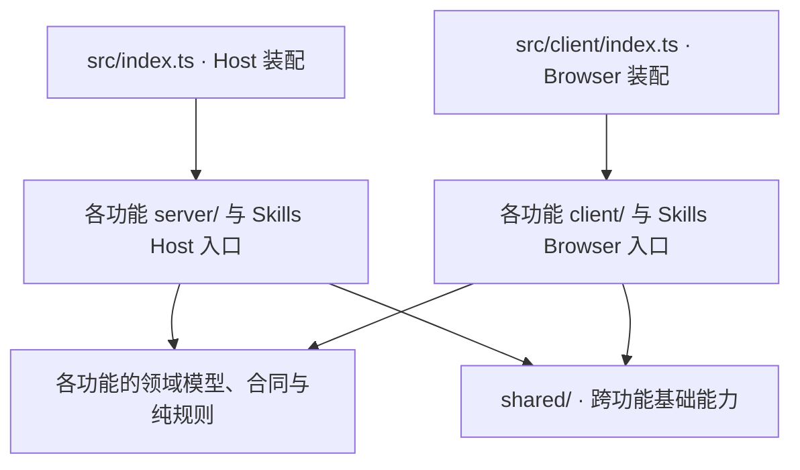

# 当前代码架构与文件职责

更新日期：2026-10-30。本页描述职责拆分后的实际源码；本轮范围和验证见
[职责重构验证记录](responsibility-refactoring-validation.md)。

项目按外观、调优、技能三个功能组织，每个功能内部区分浏览器、宿主和纯逻辑。
保留 Host / Browser 两个包入口及 Skills 原有子插件边界；入口只装配服务、页面、路由和清理函数。
此次在 ADR-0002 的功能目录基础上继续拆分内部职责；ADR 和此前方案保留当时的历史含义。

## 依赖方向

- 外观、调优、技能之间不互相引用；共用基础能力放在 `shared/`。
- `shared/` 不反向依赖功能和入口；功能实现不运行时引用入口，也不使用转发空壳维持旧内部路径。
- 浏览器运行时依赖不得到达 `server/`、Node 内置模块或宿主适配；跨端只共享数据合同、纯规则和纯类型。
- SDK 类型继续来自正式 npm 包；公共 SDK 缺失的宿主接口由本地窄接口描述。
- 源码运行时依赖图无环。`tests/architecture.spec.ts` 持续检查上述边界和 800 行上限。

## 装配与共享

| 文件 | 职责 |
| --- | --- |
| `src/index.ts` | Host 配置、壁纸库和调优路由装配、Skills 子插件挂载。 |
| `src/client/index.ts` | Browser 页面注册、控制器创建、样式注入、Skills 子插件挂载及生命周期清理。 |
| `src/client/settings-nav.ts` | 外观/调优导航声明及 DOM 标记观察器。 |
| `src/client/styles.ts` | 拼接各功能样式并幂等注入；保持原级联顺序。 |
| `src/shared/config.ts` | 插件配置和默认值。 |
| `src/shared/browser-env.ts` | 浏览器宿主服务窄接口及 settings 插槽类型增强。 |
| `src/shared/host-env.ts` | 跨功能 Host 服务窄接口。 |
| `src/shared/request.ts` | 外观/调优共用请求标记和回环地址判断。 |
| `src/shared/styles.ts` | 跨功能页面、控件基础样式。 |

## 外观

| 文件（相对 `src/appearance/`） | 职责 |
| --- | --- |
| `client/AppearancePage.tsx` | 外观页面及用户事件与控制器的连接。 |
| `client/LibraryPicker.tsx` | 壁纸库选择、上传、图片/视频标签和缩略图交互。 |
| `client/controller.ts` | saved/draft/live 状态、预览/退出/保存/撤销/重置、主题订阅和异步恢复编排。 |
| `client/model.ts` | 外观配置、壁纸种类和默认参数。 |
| `client/storage.ts` | localStorage、IndexedDB、已保存配置恢复和持久化。 |
| `client/host-appearance.ts` | 宿主 DOM、CSS token、壁纸元素、视频 URL 资源与强制深色外观的应用/清理。 |
| `client/wallpaper.ts` | 图片/视频解码、像素采样与明暗分布提取。 |
| `client/library.ts` | 壁纸库 HTTP 客户端。 |
| `client/styles.ts` | 外观页面与壁纸宿主覆盖样式。 |
| `server/library.ts` | 壁纸库 list/upload/file 路由、请求校验、文件响应。 |
| `color.ts` | 颜色运算和对比度。 |
| `skins.ts` | 种子色生成外观 token。 |
| `sample.ts` | 像素网格的纯取色算法。 |
| `tone.ts` | 壁纸明暗分布与外观判定。 |
| `media.ts` | 媒体类别、文件名、内容类型与 Range 规则。 |

状态转换在 controller，读写介质在 storage，DOM 副作用在 host-appearance，解码在 wallpaper。
修改某项能力时沿此边界定位，不把持久化或宿主 DOM 操作重新塞回页面。

## 调优

| 文件（相对 `src/tuning/`） | 职责 |
| --- | --- |
| `contracts.ts` | 模型窗口、压缩值、保存请求、目标、快照及视图合同。 |
| `rules.ts` | 默认/推荐值、输入校验、请求解析、压缩预算公式。 |
| `config-mapping.ts` | 宿主插件配置结构与调优值之间的纯读写变换。 |
| `targets.ts` | 目标键、作用域内模型、目标选项及快照模型适配。 |
| `server/host-env.ts` | 调优专用 configEditor、LLM、预设等宿主接口。 |
| `server/model-access.ts` | 宿主模型/路由定位、枚举、解析与批量读取。 |
| `server/snapshot.ts` | 组合模型与预设，生成页面快照。 |
| `server/save.ts` | 解析实际写入目标、顺序执行模型/预设配置写入。 |
| `server/routes.ts` | HTTP 校验、读取请求、错误映射及查询/保存调用。 |
| `client/api-client.ts` | 调优请求与响应处理。 |
| `client/useTuningForm.ts` | 表单状态、加载、切换、预算派生、推荐值与保存流程。 |
| `client/TuningPanel.tsx` | 保留 TuningPanel/TuningPage 组件边界，装配两个区域及保存状态栏。 |
| `client/ModelWindowPanel.tsx` | 模型窗口区域的普通渲染函数。 |
| `client/CompactionPanel.tsx` | 压缩区域、预算摘要的普通渲染函数。 |
| `client/fields.tsx` | 调优字段展示与 token 格式化。 |
| `client/Select.tsx` | 调优专用下拉选择控件。 |
| `client/styles.ts` | 调优页面样式。 |

两个区域是普通函数调用，避免本次拆分增加 React 组件身份和挂载边界。
新校验进 rules，配置结构变换进 config-mapping，宿主查询/写入分别进 snapshot/save。

## 技能：模型与适配

| 文件（相对 `src/skills/`） | 职责 |
| --- | --- |
| `index.ts` | Host 子插件装配：Provider、唯一 commands 实例、HTTP handler 与工具注册。 |
| `client.ts` | Browser 子插件与技能页面装配。 |
| `model.ts` | 技能根、条目、分类、策略、扫描和同步等领域类型。 |
| `contracts.ts` | HTTP 数据视图、创建/导入/同步合同与类型化 ApiRoutes。 |
| `browser-host.ts` | 技能浏览器宿主接口及 loader、文件夹选择等扩展类型。 |
| `host-types.ts` | 技能宿主服务窄接口。 |
| `primitives.d.ts` | UI primitives 类型适配。 |
| `readonly-discovery.ts` | 其他 Agent 技能来源的只读发现适配。 |
| `destination-picker.ts` | 创建/导入目标选择规则与 payload 转换。 |
| `source-select.ts` | 来源选择菜单及 Escape 事件处理。 |
| `sidebar-entry.ts` | 技能可选侧边栏入口及其宿主交互。 |
| `settings-nav-icon.ts` | 技能设置导航图标标记。 |

## 技能：Host

| 文件（相对 `src/skills/server/`） | 职责 |
| --- | --- |
| `types.ts` | 仅服务端使用的作用域、队列、日志和变更选项。 |
| `router.ts` | HTTP 方法与路径分发、入队、状态码/响应及通知失败处理。 |
| `http-policy.ts` | 来源/写请求校验、body 限额与读取。 |
| `request-scope.ts` | 按请求/session 解析项目、根和目标作用域。 |
| `commands.ts` | HTTP/工具共用的唯一队列，以及各操作的业务编排与成功通知声明。 |
| `create-skill-tool.ts` | create_skill 工具合同、注册及 commands 调用。 |
| `host-integration.ts` | 宿主目录通知、工作区/session 查询、Provider 注册及动态信任配置。 |
| `queries.ts` | 页面状态与工作区技能快照组合。 |
| `provider.ts` | 可加载候选筛选、locator 和技能读取复验。 |
| `source-roots.ts` | 来源根枚举与定位。 |
| `root-access.ts` | 根路径与项目作用域访问检查。 |
| `entry-access.ts` | 技能条目访问、详情与打开文件夹。 |
| `skill-scan.ts` | 技能扫描及展示条目构造。 |
| `skill-document.ts` | SKILL.md 解析、文档检查与结构生成。 |
| `skill-create.ts` | 创建技能目录与文档。 |
| `skill-import.ts` | 本地导入预检、冲突策略及落盘。 |
| `upload-import.ts` | 上传文件/目录/ZIP 的解码与导入。 |
| `skill-sync.ts` | 外部技能复制、覆盖/跳过及同步状态。 |
| `sync-records.ts` | 同步记录读取与写入。 |
| `content-digest.ts` | 技能目录内容摘要。 |
| `content-limits.ts` | 导入/复制内容限额。 |
| `file-operations.ts` | 受约束的文件树检查与复制。 |
| `policy-store.ts` | 本地策略状态持久化、迁移和侧边栏开关。 |
| `policy.ts` | 技能/来源启停策略计算和变更。 |
| `categories.ts` | 分类增删改、分配、顺序和批量启停。 |
| `trash.ts` | 回收、恢复和永久删除。 |
| `workspaces.ts` | 工作区路径及仓库目标的验证/构造。 |
| `audit-log.ts` | 技能操作审计日志落盘。 |

HTTP 与 create_skill 必须使用同一个 commands 实例，不得分别创建队列。
新增操作时，HTTP 合同归 contracts，协议处理归 router/http-policy，具体业务归对应能力模块，
调用编排归 commands；已有复杂文件操作保留完整边界，不按行数机械切分。

## 技能：Browser

| 文件（相对 `src/skills/client/`） | 职责 |
| --- | --- |
| `manager-page.tsx` | 会话壳层与页面组合，不持有创建/导入/同步的具体流程。 |
| `manager-types.ts` | 页面/session、筛选、弹窗状态、结果与 post 类型。 |
| `widget-types.ts` | Modal、来源选择等基础控件 props。 |
| `useSkillCatalog.ts` | 全局技能快照、刷新生命周期、工作区目录组合。 |
| `useWorkspaceCatalog.ts` | 工作区列表/详情、缓存、请求 epoch 与卸载失效。 |
| `useSkillCommands.ts` | 共用 busy/inflight、post、打开目录和按 scope 展示结果。 |
| `useSkillFilters.ts` | 来源/状态/文本筛选、列表和计数派生。 |
| `useSkillCreate.ts` | 创建表单、目标和提交。 |
| `useSkillImport.ts` | 导入目标、原生文件选择、上传选择和提交。 |
| `useSkillDetail.ts` | 详情读取、复制及其反馈状态。 |
| `useSkillSync.ts` | 同步弹窗状态与提交。 |
| `useSkillCategories.ts` | 分类弹窗、候选、提交/删除、拖放和串行批量分配。 |
| `create-dialog.tsx` | 创建弹窗展示。 |
| `import-dialog.tsx` | 导入弹窗展示。 |
| `detail-dialog.tsx` | 详情弹窗展示。 |
| `sync-dialog.tsx` | 同步弹窗展示。 |
| `delete-dialogs.tsx` | 移入回收站与永久删除确认弹窗。 |
| `category-dialogs.tsx` | 分类相关弹窗展示。 |
| `source-tree.tsx` | 来源与分类树渲染。 |
| `skill-rows.tsx` | 技能行展示与拖放事件连接。 |
| `scope-panels.tsx` | scope 标签、用户/项目/回收站面板。 |
| `controls.tsx` | 共用基础控件。 |
| `api-client.ts` | 普通/session HTTP 请求及错误处理。 |
| `selectors.ts` | 列表筛选和状态统计的纯函数。 |
| `uploads.ts` | 上传选择检查及请求体编码。 |
| `messages.ts` | 翻译函数、错误与结果文案组合。 |
| `locales/zh.ts`、`locales/en.ts` | 双语词典。 |
| `icons.tsx` | 图标定义。 |
| `styles.ts` | Skills 样式。 |

壳层持有 scope、已保存筛选和展开状态；按 session key 重挂载的视图持有请求、表单与弹窗状态。
post、打开目录和分类批量操作共用同一个 inflightRef。详情读取沿用原 busy 行为。
不要把独立 hook 再聚合成覆盖全页行为的万能 manager。

## 保持原行为的约定

- 外观 save 在持久化完成前更新 saved/draft/live；保存失败吞掉并记录，reset 的持久化失败继续传播。
- 主题订阅、异步视频恢复、定时器和 URL 释放时机保持原行为。
- 调优先检查宿主写入能力，再读 body；模型/预设按原顺序写入，保留部分成功的失败语义。
- Skills 除 browse 外的 POST 都排队，包含读取操作和未知操作；GET/HEAD/browse 沿用原处理方式。
- HTTP 写成功后的通知异常被吞，工具通知异常向调用方传播；失败不能阻塞后续排队操作。
- 普通 post 等待全局/目标工作区刷新后解锁；分类批量操作首错停止，finally 先解锁再发起刷新。
- class/style、DOM、文案、存储键、路径、API、工具合同、组件身份和 session 生命周期不因职责拆分而调整。

## 日常验证

`pnpm typecheck` 使用 noEmit 类型检查；`pnpm test` 覆盖功能、宿主合同、生命周期与架构边界。
纯重构时先跑这些检查，并核对改动涉及的资源和异步时序。
构建必须获得用户明确要求或批准；本轮没有执行构建，真实宿主视觉/HMR 和最终 bundle 不属于已验证结果。
