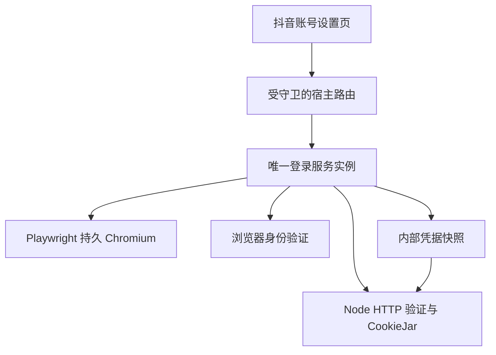

# 抖音登录一期实施计划

日期：2026-10-30。状态：关键选择已确认，方案待整体评审，尚未实施。

## 1. 目标与已确认决策

在 `dsh-custom-center` 的设置中新增独立「抖音账号」页面，让用户在真实浏览器完成登录，持久保存会话，并把 Cookie 同步为宿主内部可用的凭据，为后续 HTTP 功能准备基础。

| 决策 | 用户确认结果 |
| --- | --- |
| 功能归属 | 在本项目实现；`dsh-douyin-scroll` 与 `dsh_douyin_tools` 只作参考 |
| 登录方式 | Node.js + Playwright，真实可见浏览器，由用户完成扫码、短信和验证码 |
| 浏览器 | 使用与 Playwright 版本匹配的配套 Chromium；不依赖用户安装 Chrome |
| Cookie 用途 | 仅供宿主内部调用；不提供下载、复制、明文展示或外部凭据接口 |
| 验收环境 | macOS 本机 DSH；一期单账号，关闭窗口保留会话 |
| HTTP 失败语义 | 浏览器登录与 HTTP 可用性分开记录；HTTP 失败不直接判掉线 |
| 范围收敛 | 本期不提供账号切换、清除登录、私信读取、私信回复或跨系统支持承诺 |

本轮交付计划、术语和架构决策记录，不安装依赖、不操作账号、不修改运行代码。

## 2. 两个项目的参考结论

| 项目 | 可参考的机制 | 本项目需要修正的地方 |
| --- | --- | --- |
| scroll | 独立浏览器 profile；浏览器层获取 HttpOnly Cookie；导出供 HTTP 使用 | 不按 Cookie 名称存在就认定登录；不将所有域 Cookie 拼成一串；不复制 Windows PowerShell 浏览器控制逻辑 |
| tools | Playwright 持久上下文；用户在网页完成登录和验证；登录过程有状态反馈 | 实际启动并导航后才能声称窗口已开；不把头像当作可靠身份；不引入 Python/MCP 双运行时；不在登录后自动重启切换无头 |

本项目采用「Playwright 持久会话 + 宿主内部 Cookie 快照 + 双路径验证」的组合，不直接移植任何一方完整登录模块。

已核对的具体问题：

- scroll 的 `tools/qr-login.mjs:119` 只返回 `send/close`，`:383` 却使用 `c.ev()`，验证提示检测异常会被吞掉。
- 同文件 `:372` 按 Cookie 名称判登录；`:416` 使用 `domain.includes('douyin')` 并扁平化导出，会丢失域、路径等匹配条件。
- 本地 tools 当前为 `dsh-douyin-life@0.2.8`。`index.js:4133` 调用 `ensureMcp()` 后就声称打开窗口，但 `:580` 只构造客户端；进程到 `lib/mcp.mjs:34` 的 `start()` 才启动。
- tools 的 Python `_login_state` 在 `vendor/douyin-mcp/mcp_server.py:803` 合并 Cookie 和头像证据，不能替代服务端账号验证。

## 3. 用户操作与完成标准

1. 用户打开「设置 → 抖音账号」，看到当前账号、最近验证时间、Cookie 保存状态和 HTTP 验证状态。
2. 点击「打开登录窗口」。宿主真正创建持久浏览器上下文，打开固定的抖音地址，随后返回打开结果。
3. 用户在该窗口完成扫码、手机确认、短信或网页验证码。中心只提示「请在浏览器完成验证」，不收集密码或短信验证码。
4. 宿主观察登录候选证据，再请求只读的当前账号信息，取得平台返回的账号 UID。
5. 确认身份后读取浏览器 Cookie，原子保存宿主内部凭据快照。
6. 宿主用快照发起一次脱离浏览器的只读 HTTP 账号验证，检查返回 UID 与浏览器身份一致。
7. 页面显示「已登录，凭据已保存」；HTTP 成功时显示「HTTP 已验证」，失败时显示「HTTP 待验证」及可重试原因。
8. 用户可以关闭登录窗口。关闭操作保留 profile 和凭据；不自动启动另一个无头浏览器。

「本次登录完成」要求浏览器身份已确认且凭据保存成功。只有浏览器成功、保存失败时显示「已登录，凭据保存失败」，不能提示全部完成。

「一期功能验收完成」还要求至少一次真实 HTTP 同 UID 验证成功。发生临时失败时允许保留登录状态，不等于跳过 HTTP 路径的交付验收。

## 4. 功能与依赖边界

沿用 ADR-0002 的按功能组织原则，新增独立 `douyin/`，不把业务加入 `shared/`。既有三项功能与抖音功能互不运行时引用。补充第四项功能是新增范围，不重新搬迁既有目录。



建议文件职责如下；实际实现按职责合并小文件，不机械制造转发层。

| 文件 | 职责 |
| --- | --- |
| `src/douyin/contracts.ts` | 页面状态、错误码、路由请求响应的纯数据合同，不含 Cookie 值 |
| `src/douyin/model.ts` | 状态转换、完成条件、快照版本和内部业务类型 |
| `src/douyin/server/auth-service.ts` | 单实例编排、启动/校验/保存/关闭、并发和代次控制 |
| `src/douyin/server/browser.ts` | 配套 Chromium、固定站点导航、profile 和浏览器生命周期 |
| `src/douyin/server/identity.ts` | 固定只读身份接口与响应解析、明确未登录及暂不可确认的分类 |
| `src/douyin/server/credentials.ts` | 固定目录、完整 Cookie 元数据、原子快照保存及校验 |
| `src/douyin/server/http-client.ts` | 宿主 HTTP 请求、CookieJar 匹配、响应 Cookie 更新及 UID 校验 |
| `src/douyin/server/routes.ts` | 入口守卫、请求解析、状态码与脱敏响应 |
| `src/douyin/client/DouyinAccountPage.tsx` | 设置页、按钮和状态展示 |
| `src/douyin/client/useDouyinLogin.ts` | 有界刷新、请求去重、卸载清理与错误展示 |
| `src/douyin/client/api-client.ts` | 同源请求与标记头 |
| `src/douyin/client/styles.ts` | 宿主主题下的页面样式 |

`src/index.ts` 装配独立服务和路由；`src/client/index.ts` 通过现有 `settings.section` 插槽注册页面。导航声明和样式入口只增加装配代码。

增加 `playwright` 生产依赖；HTTP Cookie 匹配优先使用成熟的 CookieJar 库（建议 `tough-cookie`），避免手写域、路径和重名覆盖规则。依赖具体版本在实施时锁定。

Chromium 使用 Playwright 对应修订版，下载和准备作为明确的安装步骤，不在打开设置页或点击登录时静默安装。插件包与浏览器二进制分别交付，核对浏览器缓存位置在 DSH 运行环境中可访问；缺失或版本不匹配时给出准备提示。

浏览器依赖延迟加载，启动错误局限于抖音功能；不能让缺少 Chromium 导致外观、调优或技能管理不可用。打包是否保留 Playwright 所需资源必须单独验证，不能把打包器能解析 import 当作部署成功。

## 5. 浏览器与生命周期

- 一个宿主服务实例只拥有一个持久上下文，`headless: false`；profile 不使用个人日常 Chrome 数据目录。
- 开窗必须 await 上下文创建及固定抖音页面导航。页面可用但站点超时，与浏览器启动失败分别提示，不返回虚假的「窗口已打开且可登录」。
- 重复点击复用现有上下文和登录页，尽力前置窗口，不再启动第二个实例。
- 开窗、验证、保存和关闭共用服务级串行协调；客户端禁用按钮不能代替服务端互斥。
- profile 被其他实例占用时返回 `profile-busy`；不删除 Chromium 锁文件、不杀其他浏览器进程、不退回共享个人 profile。
- 关闭窗口、宿主停止和插件卸载时回收本功能拥有的资源；保留 profile。Cordis effect 持有清理责任，不能只从普通 `apply()` 返回 disposer。
- 热更新先取消旧代次任务，等待旧上下文释放后才能重新打开同一个 profile；过期回调不得写回状态或覆盖快照。
- 登录完成不自动切换无头；后续私信功能需要常驻浏览器时另行设计。

## 6. 身份与 HTTP 验证

浏览器 profile 是恢复网页会话的主要持久资料；页面上的登录结论来自平台响应。Cookie 文件只是某次会话的派生快照，存在文件不代表仍有效。

### 浏览器身份

Cookie 非空、头像可见只触发候选校验。优先在正常抖音页面环境中观察/发起当前账号只读查询，以业务成功码和非空 UID 确认身份；昵称只是展示，不能作为主键。`uid_tt` 等 Cookie 值不直接充当已验证 UID。

scroll 的 `/aweme/v1/web/user/profile/self/` 可作为候选接口，但一期前置验证必须实际确认当前可用性、请求方法、响应结构及是否需其他参数。禁止把历史代码中「无需签名」注释写成保证。没有可靠身份响应时停在「待确认」，不能退回只看 Cookie 就成功。

### 宿主 HTTP

使用 Node HTTP 客户端和保存后的 CookieJar，对同一固定、只读、允许的账号接口验证；不能用共享浏览器上下文的请求代替这项测试，否则无法证明 Cookie 已可供独立 HTTP 使用。

验证记录绑定 `accountUid + credentialGeneration + checkedAt`，同时记录当次浏览器 User-Agent。UA 只是请求上下文；不把所有浏览器请求头照搬，也不承诺 UA 加 Cookie 足够。

只在 HTTP 业务成功且 UID 一致时记为 `verified`。网络失败、限流、挑战页、签名失败或响应结构变化分别记录原因；HTTP UID 不一致记为 `identity-mismatch`，阻止该代次凭据继续被内部业务消费，并提示重新验证。

Cookie 并不保证未来所有接口都可用。私信可能另需 CSRF、动态参数、签名、Token、WebSocket 或长连接；一期不逆向这些协议。若固定身份接口也必须签名，先明确阻塞和后续工作，再决定是否扩大一期范围。

## 7. 状态合同

不要用一个 `loggedIn` 布尔值表示整个功能。

| 维度 | 建议取值 | 含义 |
| --- | --- | --- |
| 操作阶段 `phase` | `idle / opening / waiting-user / verifying / saving / closing / error` | 当前操作，可重试错误不覆盖已保存身份事实 |
| 浏览器认证 `auth` | `unchecked / authenticated / unauthenticated / unknown` | 未检查、已确认、明确未登录、暂不可确认 |
| 凭据 `credentials` | `absent / saved / stale / save-error` | 本地快照状态，绑定账号和代次 |
| HTTP `http` | `not-checked / checking / verified / unconfirmed / rejected` | 记录该代次的独立 HTTP 验证结果 |
| 窗口 `browserOpen` | 布尔值 | 与账号登录状态分离 |

主要流程：`opening → waiting-user → verifying → saving → idle`。已有会话时可直接验证，不强制重新扫码。短信/验证码提示只能作辅助提示，识别不到时统一提示用户查看真实浏览器，不能阻塞正常登录。

宿主重启后快照先按「上次已保存，当前未验证」展示；不因文件存在直接恢复 `authenticated` 或当前 `verified`。打开窗口/用户主动重试后重新确认。临时网络错误进入 `unknown/unconfirmed`，保留资料；明确未登录使凭据标记过期，停止向业务提供。

内部 HTTP 如果更新了 Cookie，形成新凭据代次；不能让旧的 `verified` 自动覆盖新代次。浏览器仍打开时，以重新读取浏览器并验证为最终发布入口，不承诺 HTTP 与浏览器 Cookie 双向同步。账号 UID 发生变化时停止自动覆盖，提示当前单账号范围不支持切换。

建议默认值：登录观察每 3 秒一次，仅做轻量检查；身份验证串行且至少间隔 10 秒，暂时失败指数退避；单次网络请求 15 秒超时。等待用户操作 10 分钟后暂停自动观察，保留窗口并允许「检查登录状态」继续，不强制重开。

## 8. 数据与 Cookie 快照

数据根由宿主确定。优先使用宿主已提供的 `DSH_PROFILE_DIR` 下 `data/dsh-custom-center/douyin/`；无 profile 时回退到 `DSH_HOME` 或 `~/.dsh` 下固定插件数据子目录。实施前核实当前 DSH 的目录语义，确保不同 profile 隔离。

```text
<插件数据根>/douyin/
  browser/                Chromium 持久 profile
  auth/credentials.json   内部凭据完整快照
```

快照以单文件 envelope 保存身份和 Cookie，避免多文件部分更新产生错配。包含：`schemaVersion`、`generation`、`account.uid/nickname`、`exportedAt`、`browserVerifiedAt`、`userAgent` 和 Cookie 集合。HTTP 验证结果引用同一代次；状态接口只投影脱敏信息。

Cookie 集合保留 `name/value/domain/path/expires/httpOnly/secure/sameSite`，并在浏览器提供时保留 partition 等扩展信息。记录会话 Cookie 和持久 Cookie 的差异；CookieJar 适配要验证 host-only/domain 语义，对不支持的分区 Cookie 不擅自转成普通 Cookie。

仅接受明确允许的抖音域边界，例如 `douyin.com` 或 `.douyin.com` 的子域规则；不使用字符串 `includes`，不顺带导出无关字节域名。真实登录若依赖额外域，依据抓到的实际请求另行审查允许列表。

每次 HTTP 请求由 CookieJar 按固定目标的 scheme、domain、path、过期时间等筛选，不能把所有 Cookie 扁平拼接。重名 Cookie按成熟库规则处理。重定向逐跳校验站点边界，禁止向未知域转发凭据。

文件写入采用同目录临时文件再 rename；macOS 目录限制为当前用户、文件 `0600`。凭据目录和写入目标验证归属，拒绝越界或异常符号链接；不对 Chromium 自己的内部文件机械套用禁用符号链接规则。

保存失败保留上一份完整快照并明确标记错误，不能把旧凭据展示成本次成功。损坏或未知 schema 的快照隔离处理，不直接解析后供业务消费。浏览器 profile 不提交到 Git，也不写进会话日志或 Agent 上下文。

## 9. 宿主接口与安全边界

所有页面路由统一要求回环 socket、宿主 `connection.requestRejection` 通过和 `x-dsh-custom-center: 1` 标记。标记头只是请求约定，不能代替宿主认证和来源校验；不启用跨域访问。

| 路由建议 | 行为 |
| --- | --- |
| `GET /custom-center/douyin/status` | 返回账号摘要、四维状态、时间和脱敏错误；不启动浏览器、不返回 Cookie |
| `POST /custom-center/douyin/login/open` | 创建或复用窗口并导航，返回实际结果 |
| `POST /custom-center/douyin/login/check` | 合并重复校验请求，触发身份验证、凭据保存和必要的 HTTP 验证 |
| `POST /custom-center/douyin/login/close` | 幂等关闭本功能窗口并取消观察；保留会话 |

POST body 只接受约定的有限字段；不接收任意 URL、文件路径、浏览器执行路径、JS 或 HTTP 代理请求。响应均 `no-store`；日志不含 Cookie、Token、完整响应体或个人验证码。

服务内部预留「读取脱敏状态」「取得指定固定用途的已验证请求上下文」的逻辑边界，一期只由账号校验调用。不建立通用 HTTP 代理，也不提前注册私信工具。未来跨插件使用时再通过 Cordis 服务正式发布合同，不能 import 兄弟插件内部文件；当前不虚构尚未核实的自定义服务 API。

## 10. 分步实施与交付门槛

### P0：证明运行链路

在 macOS 本机 DSH 环境验证：插件可解析 Playwright、配套 Chromium 可用、持久上下文能打开固定站点、关闭重开可恢复会话、浏览器身份和 Node HTTP 身份路径均可取得同 UID。

先完成最小技术验证，再扩展 UI。若浏览器资源不能随当前安装机制正确部署，或身份接口不可用，记录具体阻塞，不在 UI 层伪造成功，也不默默退回 Python 或系统 Chrome。

### P1：宿主登录核心

实现浏览器管理、状态模型、身份适配、CookieJar 和原子快照、并发锁与代次取消；增加针对状态和故障的测试。所有入口共用一个服务实例。完成四个受守卫路由。

### P2：设置页集成

增加「抖音账号」页面，展示真实状态和必要操作。刷新采用轻量、有界机制：页面卸载停止请求；后台宿主观察有超时和退避；页面重新挂载只获取当前状态，不重新开窗。

### P3：生命周期与回归

验证窗口关闭、宿主重启、HMR、profile 占用、网络错误和磁盘失败；确认其他三个功能不受影响。更新架构说明、功能介绍和两份 README；把 `douyin` 加入现有架构测试的 feature 识别，防止新增目录漏检。

### P4：安装环境验收

在明确的安装工作流中准备配套 Chromium，核实版本与资源路径；进行真实登录及独立 HTTP 同 UID 验证，记录环境、版本、时间和脱敏结果。构建、安装到运行中 DSH、账号实际操作作为独立执行动作，按届时用户授权进行。

本计划本身不执行任何上述运行或构建操作。后续代码验证优先 `pnpm typecheck`（noEmit）、针对性测试和相关回归；构建仍须用户明确要求或批准，不因计划列出该步骤即视为已授权。代码不自动提交。

## 11. 验收矩阵

| 场景 | 必须观察到的结果 |
| --- | --- |
| 首次无会话 | 真正打开 Chromium 和抖音页，显示等待用户操作 |
| 浏览器缺失/启动失败/导航失败 | 对应的可诊断状态，无虚假成功，其他功能正常 |
| 连点开窗或多次 check | 一个上下文、一组观察任务、校验合并或串行 |
| 扫码后手机未确认、短信或验证码 | 可在真实窗口继续完成；不重复刷新登录流程 |
| 有 session Cookie但账号接口拒绝 | 不能显示已验证登录 |
| 浏览器身份确认并保存 | UID 正确、文件完整、权限受限、页面不含凭据 |
| 独立 HTTP 验证成功 | 返回同 UID，记录代次和时间，证明未借用浏览器请求上下文 |
| HTTP 超时、限流、挑战或签名失败 | 保留浏览器登录和快照，标记 HTTP 待验证 |
| HTTP UID 不一致 | 拒绝内部消费该凭据，不覆盖已确认账号 |
| Cookie 域/路径/重名/过期/跨域重定向 | 严格筛选；相似恶意域、无关目标收不到 Cookie |
| 凭据写入失败或快照损坏 | 不发布半份或旧代次成功结果，可明确重试 |
| 关窗及重启 | 保留会话，重启展示上次资料但重新验证当前有效性 |
| HMR、插件卸载、profile 占用 | 清理资源、无旧回调覆盖、无第二实例争抢 |
| 非回环/跨来源/缺标记/任意路径或 URL | 请求被拒绝，无凭据读取和任意请求能力 |
| 打开后登录到另一个 UID | 不静默切换单账号身份，停止发布并提示限制 |

自动化重点测试状态边界、原子保存、Cookie 匹配、守卫和生命周期；账号真实登录由人工验收，测试夹具不包含真实 Cookie。

## 12. 后续私信能力如何衔接

后续私信模块复用已验证的账号归属、凭据代次、固定站点 HTTP 客户端和失效反馈。先验证具体私信查询/发送协议与认证材料，再选择 HTTP、浏览器或连接方案；本期不预留未经证实的私信 URL、签名算法或消息轮询接口。

账号登录、HTTP 当前账号验证、私信读取和发送是四项不同能力。前两项做好基础，不代表后两项已实现或必然可直接使用 Cookie 调用。

## 13. 依据与评审记录

- 决策访谈：Q1 功能归属、Q2 仅内部 Cookie、Q3 Node Playwright、Q4 macOS 单账号及保留会话、Q5 双状态、Q6 配套 Chromium，均已按用户答复记录。
- [架构决策 ADR-0003](adr/0003-douyin-login-session-ownership.md)。
- [当前架构](architecture.md)、[ADR-0002](adr/0002-feature-oriented-organization.md)、[项目术语](../GLOSSARY.md)。
- 本地 tools：`../dsh_douyin_tools`，核对时 HEAD 为 `b73a237689803d86a97b135563f0421077ef9fa8`，包版本 `0.2.8`。
- scroll：[登录脚本固定版本](https://github.com/NEWJO123/dsh-douyin-scroll/blob/7c6e2a2ff3443eee89c4935c1304df5822b40e65/tools/qr-login.mjs)、[宿主入口](https://github.com/NEWJO123/dsh-douyin-scroll/blob/7c6e2a2ff3443eee89c4935c1304df5822b40e65/index.js)。本轮核查对象为先前下载的源码快照，其解压目录无 `.git`，版本标识沿用前轮记录，未重新验证远端 HEAD。
- 当前只核查源码和设计约束；尚未证明 Chromium 在 DSH 中部署成功，也未进行实际账号或 HTTP 验证。
